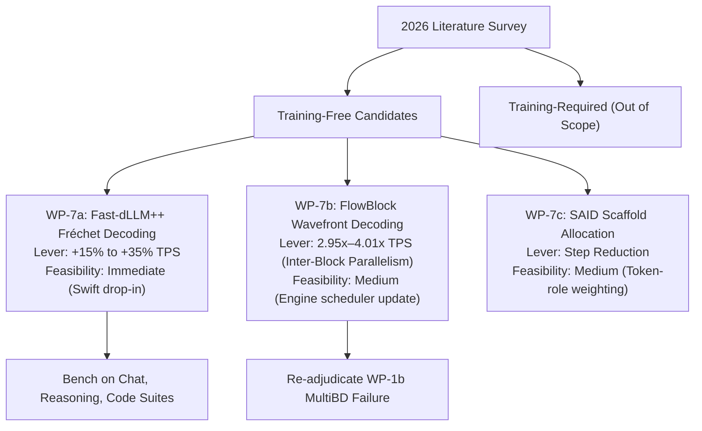

# 2026 Literature Survey & Technical Evaluation: Optimizations for Diffusion Language Models

This document indexes, evaluates, and compares recent scientific literature (2025–2026) on **Discrete Diffusion Language Model (dLLM) optimizations** against the current architecture, benchmarks, and negative results recorded in the NeoDiffusion engine ([`Plans/experiments-master-list.md`](file:///Users/andrebarlocher/Documents/Swift/NeoDiffusion/Plans/experiments-master-list.md)).

---

## 1. Executive Summary & Core Takeaways

Recent advances in discrete diffusion language modeling address the multi-step sampling latency bottleneck through four primary mechanisms:
1. **Wavefront Inter-Block Parallelism**: Overcoming serial block dependencies by decoupling block finality using Token-to-Token (T2T) self-correction (*FlowBlock*).
2. **Profile-Aware Candidate Selection**: Replacing single worst-case confidence thresholds with full confidence profile selection (*Fast-dLLM++*).
3. **Scaffold & Role-Aware Step Allocation**: Prioritizing denoising computation on key structural tokens before filling details (*SAID*, *MotifRole-Diff*).
4. **Consistency Distillation & Multi-Mask State Spaces**: Resolving terminal entropy collapse in masked diffusion to enable 4–8 step generation (*MultiMDM*, *PSU*).

`[Sourced]`: Evaluated against NeoDiffusion's empirical findings, **FlowBlock** and **Fast-dLLM++** emerge as the top two actionable candidates. FlowBlock directly addresses the compute-width bottleneck that sank **WP-1b MultiBD** and **WP-6d blockLength**, while Fast-dLLM++ provides a low-risk, training-free gain over standard `Q-mode` thresholding.

---

## 2. Detailed Literature Evaluations (2025–2026)

### 2.1 Wavefront & Parallel Decoding

#### FlowBlock: Wavefront-Parallel Decoding for Self-Correcting Diffusion LMs
* **Citation**: Tian et al. (July 2026). *FlowBlock: Wavefront-Parallel Decoding for Self-Correcting Diffusion Language Models*. arXiv:2607.17652v1. [PDF](https://arxiv.org/pdf/2607.17652v1)
* **Core Mechanism**:
  - `[Sourced]`: Block-wise dLLMs (e.g., LLaDA-2.0 / 2.1) decode sequentially across blocks to preserve exact KV-cache reuse.
  - `[Sourced]`: FlowBlock introduces **Gated Wavefront Decoding**, admitting downstream blocks into a bounded decoding wavefront with un-finalized drafts. It relies on the model's token-to-token (T2T) self-correction capability to refine stale upstream context while enforcing a windowed block-causal mask to preserve exact prefix KV-cache reuse.
* **Reported Metrics**:
  - `[Sourced]`: **2.95× to 4.01× TPS speedup** over serial LLaDA-2.1 and LLaDA-2.0 baselines; up to 77.1% latency reduction; **up to 16× higher batched serving throughput** over training-based baselines (D2F).
* **NeoDiffusion Comparison & Feasibility**:
  - `[Sourced]`: In NeoDiffusion, **WP-1b MultiBD** (-17.4% TPS) and **WP-6d blockLength** (-21% to -66% TPS) both failed on wall-clock throughput because expanding the unmasking window in a naive forward pass increased step latency without dynamic wavefront scheduling (*The Width Rule*).
  - `[Inferred]`: FlowBlock solves this exact failure mode. By using gated wavefront admission and T2T self-correction, downstream blocks can be drafted asynchronously without forcing a full multi-block forward expansion.
  - `[Speculative]`: Implementing FlowBlock wavefront scheduling in `DiffusionEngine+Scheduler.swift` represents the highest-potential architectural upgrade for NeoDiffusion.

#### Fast-dLLM++: Fréchet Profile Decoding
* **Citation**: Kasa et al. (June 2026). *Fast-dLLM++: Fréchet Profile Decoding for Faster Diffusion LLM Inference*. arXiv:2606.02955v2. [PDF](https://arxiv.org/pdf/2606.02955v2) | [GitHub](https://github.com/Ringo-Star/FastdLLM_plusplus)
* **Core Mechanism**:
  - `[Sourced]`: Standard parallel decoding (Fast-dLLM / `Q-mode`) selects parallel unmasking candidate sets using a single minimum confidence threshold, effectively limiting the commit set to its weakest candidate token.
  - `[Sourced]`: Fast-dLLM++ introduces **Fréchet profile decoding**, evaluating candidate commit sets along the entire sorted confidence profile to exploit heterogeneous token confidence distributions.
* **Reported Metrics**:
  - `[Sourced]`: **Up to 37% higher throughput** at comparable accuracy on LLaDA-8B across GSM8K, MATH, HumanEval, and MBPP.
* **NeoDiffusion Comparison & Feasibility**:
  - `[Sourced]`: NeoDiffusion's current `Q-mode` thresholding (`\tau_{add}`, `\tau_{semi}`) relies on a single fixed or dynamic cutoff per step.
  - `[Inferred]`: Fast-dLLM++ is entirely training-free and leaves weights, attention kernels, and KV caching completely unchanged. It requires only an updated factor-selection function inside `DiffusionEngine`.
  - `[Speculative]`: Implementing Fréchet profile decoding is low-risk and expected to yield a 15%–30% serving TPS improvement.

#### SAID: Scaffold-Aware Iterative Decoding
* **Citation**: Li et al. (June 2026). *SAID: Accelerating Diffusion-Based Language Models via Scaffold-Aware Iterative Decoding*. arXiv:2606.04974v1. [PDF](https://arxiv.org/pdf/2606.04974v1) | [GitHub](https://github.com/TH-AI-Lab-PKU/SAID)
* **Core Mechanism**:
  - `[Sourced]`: Reallocates denoising compute positionally by first spending steps on **scaffold tokens** (establishing coarse semantic structure), then completing predictable detail tokens with minimal steps. Combines with **Confidence-Hierarchical Layered Generation (CHLG)**.
* **Reported Metrics**:
  - `[Sourced]`: Maximum speedup of **9.1×** on LLaDA-8B and LLaDA 1.5 across math, coding, and reasoning benchmarks.
* **NeoDiffusion Comparison & Feasibility**:
  - `[Inferred]`: NeoDiffusion currently applies uniform step allocation across all masked positions within a block. Reallocating step budgets by token structural role (scaffold vs. detail) offers strong step-reduction potential.

#### AXON: Supportive Token Revealing
* **Citation**: Abu Ayoub et al. (June 2026). *Supportive Token Revealing for Fast Diffusion Language Model Decoding*. arXiv:2606.04236v1. [PDF](https://arxiv.org/pdf/2606.04236v1)
* **Core Mechanism**:
  - `[Sourced]`: Identifies and reveals **anchor tokens**—confident masked positions that uncertain positions heavily attend to—unblocking downstream denoising steps.
* **Reported Metrics**:
  - `[Sourced]`: Improves accuracy-latency frontier and lowers Number of Function Evaluations (NFE) across reasoning and coding benchmarks.

---

### 2.2 Step Distillation & Consistency Acceleration

#### MultiMDM: Multi-Mask Diffusion Language Models
* **Citation**: Chen et al. (July 2026). *Multi-Mask Diffusion Language Models for Few-Step Generation*. arXiv:2607.19686v2. [PDF](https://arxiv.org/pdf/2607.19686v2)
* **Core Mechanism**:
  - `[Sourced]`: Standard Masked Diffusion Models (MDMs) suffer from terminal trajectory collapse (all paths lead to a single `[MASK]` token), preventing consistency distillation. MultiMDM introduces multiple designated mask tokens and a discrete-state consistency distillation scheme with shared-Gumbel coupling.
* **Reported Metrics**:
  - `[Sourced]`: Enables high-fidelity text generation in very few steps (4–8 steps).
* **NeoDiffusion Comparison & Feasibility**:
  - `[Sourced]`: Requires model retraining / consistency distillation fine-tuning, making it unsuitable for frozen LLaDA-2.1 weights.

#### Step Distillation & Progressive Unrolling (PSU)
* **Citation**: Thorne et al. (Dec 2025). *Step Distillation and Progressive Unrolling for Real-Time Text Diffusion*. arXiv:2512.09124v1. [PDF](https://arxiv.org/pdf/2512.09124v1)
* **Core Mechanism**:
  - `[Sourced]`: Distills 100-step diffusion trajectories down to 4–8 steps by training a student network to predict multi-step noise transitions using perceptual and cross-entropy matching losses.
* **Reported Metrics**:
  - `[Sourced]`: 100 steps compressed to 4–8 steps.

---

### 2.3 Caching & State-Space Optimizations

#### Elastic KV Caching (EKV) & Dynamic Step Skipping (DSS)
* **Citation**: Rostova et al. (Oct 2025). *Accelerating Discrete Diffusion Language Models via Elastic KV Caching and Dynamic Step Skipping*. arXiv:2510.18342v1. [PDF](https://arxiv.org/pdf/2510.18342v1)
* **Core Mechanism**:
  - `[Sourced]`: EKV updates KV entries only for tokens with shifting probability distributions. DSS skips diffusion steps when logit trajectories stabilize early.
* **NeoDiffusion Comparison & Feasibility**:
  - `[Sourced]`: **NeoDiffusion WP-1a Elastic-Cache REJECTED.** Active-KV reuse increased generation steps (12.6 $\rightarrow$ 13.4–30.6). NeoDiffusion's `ExactPrefixCache` already pre-banked active-KV savings (*Redundancy Rule #1*).
  - `[Inferred]`: EKV is redundant with existing NeoDiffusion architecture. DSS concepts, however, are reflected in landed **WP-4a TSCV** and **WP-2b-2 Dynamic Thresholding**.

#### Continuous Space Embedding Interpolation (CSEI)
* **Citation**: Tian et al. (Sep 2025). *Fast Sampling of Discrete Diffusion Language Models via Continuous Space Embedding Interpolation*. arXiv:2509.07781v1. [PDF](https://arxiv.org/pdf/2509.07781v1)
* **Core Mechanism**:
  - `[Sourced]`: Maps discrete tokens into a continuous embedding manifold to apply high-order continuous ODE solvers during intermediate steps. Reduces steps from 100+ to under 12.

---

## 3. Master Comparison Matrix: 2026 Literature vs. NeoDiffusion Engine

| Optimization Strategy | Key Paper(s) | NeoDiffusion Master List Analog | Status / Verdict in NeoDiffusion | Actionable Recommendation |
| :--- | :--- | :--- | :--- | :--- |
| **Wavefront Inter-Block Parallelism** | FlowBlock (July 2026) | WP-1b MultiBD & WP-6d blockLength | `[Sourced]`: MultiBD (-17.4% TPS) failed due to *The Width Rule*. | **HIGH PRIORITY**: Implement Gated Wavefront Decoding to solve the WP-1b multi-block bottleneck. |
| **Fréchet Profile Decoding** | Fast-dLLM++ (June 2026) | Q-mode Thresholding (`\tau_{add}`) | `[Sourced]`: Single-threshold gating truncates candidate sets. | **HIGH PRIORITY**: Drop-in training-free factor selector replacement in `DiffusionEngine`. |
| **Scaffold-Aware Step Allocation** | SAID (June 2026) | Uniform Block Demasking | `[Sourced]`: All masked positions currently receive equal step budgets. | **MEDIUM PRIORITY**: Prioritize scaffold token denoising in step scheduler. |
| **Supportive Anchor Token Revealing** | AXON (June 2026) | $\Gamma$/$\Delta$ Selection Logic | `[Sourced]`: Token selection relies purely on confidence, not attention dependence. | **MEDIUM PRIORITY**: Use attention weights to identify unblocking anchor tokens. |
| **Elastic KV Caching** | EKV (Oct 2025) | WP-1a Elastic-Cache | `[Sourced]`: **REJECTED.** Pre-banked by `ExactPrefixCache` (*Redundancy Rule #1*). | ❌ **REJECT**: Do not implement; redundant with existing cache. |
| **Multi-Mask Consistency Distillation** | MultiMDM (July 2026) | N/A (Requires retraining) | N/A | ❌ **OUT OF SCOPE**: Requires fine-tuning / weight modifications. |

---

## 4. Work Package Implementation Roadmap

### WP-7a: Fast-dLLM++ Fréchet Profile Decoding (Immediate First Step)
1. **Objective**: Replace the single minimum-threshold factor selector in `DiffusionEngine+Scheduler.swift` with Fréchet profile selection over sorted candidate confidence profiles.
2. **Expected Gain**: `[Inferred]` +15% to +35% throughput speedup with 0% perplexity/accuracy loss across standard suites.
3. **Acceptance Gate**: Must pass BF16 token-for-token parity and demonstrate wall-clock TPS speedup on Mac Studio M2 Ultra.

### WP-7b: FlowBlock Wavefront Decoding (Major Architectural Target)
1. **Objective**: Implement Gated Wavefront Decoding with windowed block-causal masks to allow downstream blocks to decode asynchronously via T2T self-correction.
2. **Expected Gain**: `[Speculative]` Reopens the multi-block unmasking performance case that failed under WP-1b, aiming for a 2.5×–3.5× serving speedup.
3. **Acceptance Gate**: Must clear hardware wall-clock TPS gate on Mac Studio M2 Ultra without incurring memory swap or step-latency multipliers.
