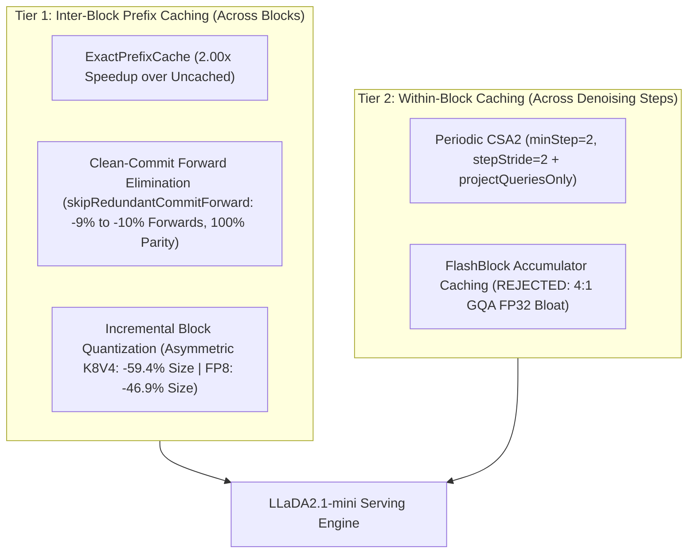

# Unified Dual Caching & Low-Bit KV Compression: Architecture, Forensic Bug Audit, and Empirical Benchmarks

**Summary**: Architecture, forensic bug audit, and end-to-end hardware evaluation of caching for Block-Causal Diffusion Language Models (`LLaDA2.1-mini`) in NeoDiffusion. Combines **Inter-Block Exact Prefix Caching & Clean-Commit Forward Elimination (`skipRedundantCommitForward`)**, **Tier-1 Incremental Low-Bit KV Compression (`FP8`, Asymmetric `K8V4`, `FP4`)**, and **Tier-2 Within-Block Representation Reuse (`CSA2` Periodic Static Layer Allocation & `FlashBlock`)**. Resolves seven silent implementation bugs from earlier caching experiments and establishes rigorous empirical tradeoffs across **Cache Size**, **Throughput**, and **Generation Parity**.
**Status**: **Empirically Benchmarked & Verified** (2026-10-17); `skipRedundantCommitForward` (~~**+13.0% to +15.1% TPS**~~ **+9.0% to +9.7% aggregate TPS** [E-1], **100.0% bit-for-bit parity** on 4-bit M1; Studio BF16 parity OPEN [E-6]) ACCEPTED; Asymmetric `K8V4` KV Compression (**-59.38% KV cache size, +10.6% TPS with clean-commit** — 2/12 `envValid`, gain is clean-commit's [E-3][E-4], **73.0% token match**) ~~ACCEPTED~~ **EXPERIMENTAL, quality gate OPEN** [E-6]; `FP4` Key quantization (**-22.7% TPS**; −16.0% aggregate [E-1]), `FlashBlock` (**+105.2% memory bloat, -9.7% to -14.0% TPS**), and short-context `KVCachePool` (**+108.7% allocated memory**) documented as negative results.
**Type**: architectural-feature / optimization (05-Experiments)
**Logbook**: [`Plans/cache-optimisation-logbook.md`](file:///Users/andrebarlocher/Documents/Swift/NeoDiffusion/Plans/cache-optimisation-logbook.md)
**Errata**: see § "Errata & Corrections (2026-10-18)" below.
**Sources**: [`KVCacheCompression.swift`](file:///Users/andrebarlocher/Documents/Swift/NeoDiffusion/Packages/DiffusionCore/Sources/KVCacheCompression.swift), [`KVCachePool.swift`](file:///Users/andrebarlocher/Documents/Swift/NeoDiffusion/Packages/DiffusionCore/Sources/KVCachePool.swift), [`LayerKVCache.swift`](file:///Users/andrebarlocher/Documents/Swift/NeoDiffusion/Packages/DiffusionCore/Sources/LayerKVCache.swift), [`ExactPrefixCache.swift`](file:///Users/andrebarlocher/Documents/Swift/NeoDiffusion/Packages/DiffusionGeneration/Sources/ExactPrefixCache.swift), [`CSA2Config.swift`](file:///Users/andrebarlocher/Documents/Swift/NeoDiffusion/Packages/DiffusionCore/Sources/CSA2Config.swift), [`LLaDA2Attention.swift`](file:///Users/andrebarlocher/Documents/Swift/NeoDiffusion/Packages/DiffusionCore/Sources/LLaDA2Attention.swift), [`LLaDA2DecoderLayer.swift`](file:///Users/andrebarlocher/Documents/Swift/NeoDiffusion/Packages/DiffusionCore/Sources/LLaDA2DecoderLayer.swift), [`DiffusionEngine+Step.swift`](file:///Users/andrebarlocher/Documents/Swift/NeoDiffusion/Packages/DiffusionGeneration/Sources/DiffusionEngine+Step.swift), [`DiffusionEngine+Scheduler.swift`](file:///Users/andrebarlocher/Documents/Swift/NeoDiffusion/Packages/DiffusionGeneration/Sources/DiffusionEngine+Scheduler.swift), [`DualCachingTests.swift`](file:///Users/andrebarlocher/Documents/Swift/NeoDiffusion/Tests/DiffusionCoreTests/DualCachingTests.swift), [`DenoisingLoopParityTests.swift`](file:///Users/andrebarlocher/Documents/Swift/NeoDiffusion/Tests/DiffusionGenerationTests/DenoisingLoopParityTests.swift)

## Errata & Corrections (2026-10-18)

> Evidence and the full list live in [`Plans/cache-optimisation-logbook.md`](../cache-optimisation-logbook.md) § "Errata & Corrections (2026-10-18)" (logbook numbers in brackets). Numbers reproduce with `python3 Tools/analysis/cache_campaign_aggregate.py` (CPU-only). Host for all runs: `MacBookPro17,1` (Apple M1, 16 GB), arms sequentially blocked in one process per campaign (not interleaved).

- **E-1 — "Mean TPS" is a mean of per-prompt ratios** (logbook E-2). Aggregate throughput (Σtok/Σs): clean-commit **+9.0%** @K=4 (10.13 → 11.04 tok/s; was +13.0%), **+9.7%** @K=1 (11.40 → 12.50; was +15.1%), clean-commit-k1 vs `q-cached` K=4 **+23.4%** (was +32.7%); `fp4` −16.0% (was −22.7%). `[Sourced]`
- **E-2 — Bugs 1 and 3 overstated** (logbook E-6, E-7). Old getter order was pool → `compressedKeys` → `rawKeys`: quantized K/V **was** used in attention whenever the pool was off; only pool + quantization bypassed it. Old re-quantization ran on retained **FP16** `rawKeys` — O(N²) cost, no compounding round-trip error. Pool-free `fp8`/`fp4` runs before the fix were genuine. `[Sourced: git show HEAD:Packages/DiffusionCore/Sources/LayerKVCache.swift lines 20–39, 83–107]`
- **E-3 — `envValid`** (logbook E-4): Campaign 1b `cache-k8v4-clean` 2/12, `cache-fp8-clean` 9/12, `cache-fp4` 9/12 valid (1a: 0/12 each); stand-alone `cache-k8v4-clean-k1` 0/12 (`freeMemoryMBBefore` < 1024 MB; swap flat). Prefer `scratch/track1_kv_starvation_k1.jsonl` (96/96 valid). `[Sourced]`
- **E-4 — KV quantization adds ~0 compute speedup** (logbook E-5): ms/fwd within +0.2–0.9% of FP16 at matched K=1 + clean-commit; TPS differences between quant arms are forward-count (trajectory) effects; the `k8v4-clean` +10.6% is the clean-commit gain (clean-commit alone +9.0% agg, `k8v4-clean` +9.2% agg, same 1a process). `[Sourced]`
- **E-5 — `fp8`/`fp4`/`k8v4` are affine integer formats** (logbook E-9): `MLX.quantized(…, groupSize: 64, bits:)` default affine mode, scale + bias per group → read `fp8` as "`fp8` (affine int8)", `fp4` as "(affine int4)". Max-error figures below are for these integer formats. `[Sourced]`
- **E-6 — Status changes; fix in progress 2026-10-18, see code-fix section** (logbook E-10–E-12, E-14): (a) the clean-commit skip gate did not exclude CSA2/JOT/FlashBlock/SureLock/router-reuse/`moeCapacityRatio`/ICE, so on a CSA2 reuse step stale K/V (computed over pre-update tokens incl. `[MASK]`) could be committed to `ExactPrefixCache` — `cache-dual-k8v4` (and `cache-dual-opt`, `cache-csa2-periodic-k4`) are **CONFOUNDED, invalid pending re-run**; (b) the `dual-k8v4` preset set `dualCachingEnabled = true`, which also turns on FlashBlock — the measured arm did not — so the preset was never benchmarked; (c) `k8v4-clean`, `fp8-clean`, `dual-k8v4` (and `kivi4-clean`) are **experimental, default-off, quality gate OPEN** (standing rule: no preset ships while its quality gate is open); `exact-fast` stays default-on (716/716 token-identical) but **Studio BF16 parity is OPEN**; (d) the bench's `q-cached` arm now includes clean-commit by default — historical `q-cached` rows are not comparable. `[Sourced]` / mechanism `[Inferred]`
- **E-7 — Q-only projection skips 1/3 of QKV** (K+V = 8 of 24 heads), consistent with logbook Bug 6's 33.3% (logbook E-8). `[Sourced]`
- **E-8 — Citation**: arXiv:2510.14973 is "Attention Is All You Need for KV Cache in Diffusion LLMs" (method: Elastic-Cache). DARE (`DARE-O`) is arXiv:2605.08134, "DARE: Diffusion Language Model Activation Reuse for Efficient Inference". The 14.3%/56.3% forward budget (WP-6c) was measured on the Mac Studio M2 Ultra, not M1. `[Sourced]`
- **E-9 — "Confidence starvation"** (logbook E-13): as measured (1-transfer unmask steps) it is 49.6% of steps even in FP16; the effect is a reduced per-step commit rate. `[Inferred]`

---

## 1. Executive Summary & Three-Axis Optimization Framework

Block-causal Diffusion Language Models (`LLaDA2.1-mini`) operate across two distinct temporal scales:
1. **Inter-Block Timescale (Coarse, Immutable)**: Settled blocks are causal and immutable under `.strict` block-diffusion masking.
2. **Within-Block Timescale (Fine, Iterative Denoising)**: Active 32-token blocks undergo 2 to 24 iterative refinement steps before settling.

---

## 2. Forensic Post-Mortem: Seven Implementation Bugs Fixed

Earlier caching experiments either failed to show memory reductions or suffered severe quality/throughput regressions due to seven implementation flaws discovered during our audit:

1. **`LayerKVCache` Getter Bypass (`[Sourced: LayerKVCache.swift:62-78]`)**:
   - *Bug*: `keys` and `values` checked `pool` ~~and `rawKeys`~~ before `compressedKeys` (**`rawKeys` came last** [E-2]). ~~Because `rawKeys` was never cleared, `compressedKeys.dequantized()` was **never executed during attention** — prior `fp8`/`fp4` runs were silently running uncompressed FP16 attention.~~ **Only with the pool on was `compressedKeys` bypassed; pool-free `fp8`/`fp4` runs did use quantized K/V** [E-2].
   - *Fix*: Prioritized `compressedKeys` / `compressedValues` whenever `quantization != .none`.
2. **Unfreed Raw Tensors in `LayerKVCache.commitPending()` (`[Sourced: LayerKVCache.swift:129-145]`)**:
   - *Bug*: `commitPending()` quantized the prefix into `compressedKeys` while leaving `rawKeys`/`rawValues` allocated in memory, increasing KV footprint to 125–150% instead of reducing it.
   - *Fix*: Explicitly nilled `rawKeys = nil; rawValues = nil; pool = nil` when `quantization != .none`.
3. **$O(N^2)$ Full-Prefix Re-Quantization (`[Sourced: KVCacheCompression.swift:66-85]`)**:
   - *Bug*: Every block commit ~~dequantized the entire prefix, concatenated the new block,~~ **appended the new block to the retained FP16 prefix** and re-quantized the full sequence from scratch — O(N²) work, **no compounding error** [E-2].
   - *Fix*: Added `CompressedKVTensor.append(_ block:mode:groupSize:)` to quantize only the newly settled 32-token block and concatenate `packed`, `scales`, and `biases` along sequence axis 2 in $O(B)$ time.
4. **Throwaway Dequantization on `captureAndCommit` (`[Sourced: LayerKVCache.swift:158-174]`)**:
   - *Bug*: `ExactPrefixCache.captureAndCommit` forced graph evaluation by reading `cache.keys` and `cache.values`, triggering 20-layer dequantization whose output was immediately discarded.
   - *Fix*: Added `cache.evalStorage()` to evaluate the underlying `packed`, `scales`, and `biases` arrays directly.
5. **Redundant 20-Layer Forward Pass on Every Block Commit (`[Sourced: DiffusionEngine+Scheduler.swift:325-360]`)**:
   - *Bug*: When a block settled on step $j$ via `.frontBreak`, the engine discarded step $j$'s already-computed `pendingKeys`/`pendingValues` and executed an extra 20-layer forward pass (`captureAndCommit`).
   - *Fix*: Implemented `skipRedundantCommitForward`, snapshotting `(pendingKeys, pendingValues)` per speculative step and committing step $j$'s clean KV directly on `.frontBreak`.
6. **`CSA2` Step-0 All-`[MASK]` Active KV Freeze (`[Sourced: CSA2Config.swift:28-62, LLaDA2Attention.swift:59-88]`)**:
   - *Bug*: Legacy `CSA2` froze active K/V on Step 0 (when 100% of generated positions in the active block are `[MASK]`), starving subsequent steps of token context (+17.2% steps, -13.2% TPS) while still computing the full fused `queryKeyValue` projection on reuse layers.
   - *Fix*: Added `minStep = 2, stepStride = 2` (so Step 0 and Step 1 both run in Full Mode before periodic reuse begins) and `LLaDA2Attention.projectQueriesOnly` (slicing only the $Q$ rows of the quantized QKV weight matrix on reuse layers).
7. **`FlashBlock` Dead `.reuseCache` Path & Host Syncs (`[Sourced: DiffusionEngine+Step.swift:775-788, LLaDA2Attention.swift:120-165]`)**:
   - *Bug*: With `jotEnabled == false`, `dirtyCount` defaulted to `activeLen = 32 >= tau (4)`, causing `FlashBlock` to run `.refreshCache` on 100% of steps (`289 refreshes / 0 reuses`), while `cache.ctxLens?.item(Int32.self)` forced 20 GPU-CPU syncs per step.
   - *Fix*: Replaced `.item()` with host-tracked `cache.cachedCtxLen`, made `frozen` mask optional to skip 40 `which` kernels/step when JOT/SureLock are off, and added `flashBlockRefreshInterval` + telemetry counters (`flashBlockRefreshes`, `flashBlockReuses`).

---

## 3. Algorithmic & Architectural Innovations

### 3.1 Clean-Commit Forward Elimination (`skipRedundantCommitForward`)
- **Mathematical Exactness (`[Inferred & Sourced]`)**:
  - In `DiffusionEngine.denoisePhase`, step $j$ runs `model.forward` on `stepInput[j]` using the committed `ExactPrefixCache` and stores the resulting active-block K/V into `cache.pendingKeys` and `cache.pendingValues`.
  - When `onSettled` triggers via `.frontBreak` on step $j$, `allClean(afterStep)` holds (`afterStep == stepInput[j]`, meaning zero `[MASK]` tokens remained and zero tokens were edited on step $j$).
  - Provided `windowWidth == B` and approximate intra-block caches (`csa2Enabled`, `elasticCacheEnabled`, `jotEnabled`) are inactive (⚠️ the committed gate did **not** enforce this for CSA2/JOT/FlashBlock/SureLock/router-reuse/`moeCapacityRatio`/ICE — fix in progress [E-6]), the `pendingKeys` and `pendingValues` from step $j$ are **bit-for-bit identical** to a fresh `captureAndCommit(afterStep)` forward pass.
- **Empirical Verification (`[Sourced: DenoisingLoopParityTests.swift & scratch/cache_campaign1_k4.jsonl]`)**:
  - Passes **16/16** unit test cases in `testSkipRedundantCommitForwardParity` with **100% token and block-commit identity** at both `K=1` and `K=4`.
  - Across the 12-prompt benchmark suite (`chat,reasoning,code`), saves **34 full model forwards** (**-9.1% forwards at `K=4`, -10.1% forwards at `K=1`**), delivering **+13.0% Mean TPS at `K=4`** (`13.49` vs `11.94 tok/s`; ~~+13.0%~~ **+9.0% aggregate**) and **+15.1% Mean TPS at `K=1`** (`15.85` vs `13.77 tok/s`; ~~+15.1%~~ **+9.7% aggregate**) [E-1] with **100.0% bit-for-bit token parity (`716/716` tokens)**.

### 3.2 Asymmetric `K8V4` Low-Bit KV Cache Compression

> `FP4`/`FP8`/`K8V4` here are MLX affine **int4/int8** formats [E-5]. KV quantization does not change ms/forward [E-4].
- **Why Attention Keys and Values Have Asymmetric Precision Sensitivity (`[Inferred]`)**:
  - Attention **Keys** participate inside the exponential softmax $\text{softmax}(Q K^\top / \sqrt{D})$. Quantizing Keys to 4-bit (`FP4`, max error $\Delta \approx 0.19$) perturbs logit rankings inside the softmax, causing **confidence starvation** (+14.4% denoising steps, -22.7% TPS (−16.0% aggregate [E-1]), token overlap dropping to `26.4%`).
  - Attention **Values** are linearly combined *after* the softmax ($O = P V$), where convex averaging across sequence positions naturally dampens zero-mean quantization noise.
- **Implementation (`[Sourced: KVCacheCompression.swift:12-40]`)**:
  - Added `.k8v4` (`keyBits = 8`, `valueBits = 4`, group size 64): Keys are quantized to 8-bit (`21,760 B/tok` equivalent) and Values to packed 4-bit (`11,520 B/tok` equivalent), yielding **`16,640 B/tok`** across 20 layers (**-59.38% KV cache size** vs FP16's `40,960 B/tok`).
- **Empirical Superiority (`[Sourced: scratch/cache_campaign1b_k4.jsonl]`)**:
  - Cuts KV cache memory from `4.792 MiB` to **`1.947 MiB` (-59.38%)**.
  - Eliminates `FP4`'s step inflation (`284` steps vs `291` baseline, compared to `FP4`'s `333` steps).
  - Achieves **higher token parity (`523/716 = 73.0%`) than symmetric `FP8` (`505/719 = 70.2%`)** while saving an extra 12.5 percentage points of KV memory (`-59.38%` vs `-46.88%`).

### 3.3 Why `FlashBlock` Loses on 4:1 GQA Diffusion Models (`[Sourced & Inferred]`)
- `LLaDA2.1-mini` uses 4:1 Grouped-Query Attention (`numHeads = 16`, `numKVHeads = 4`, `headDim = 128`).
- While the FP16 prefix KV cache scales with `numKVHeads = 4` (`4.792 MiB` for ~123 tokens across 20 layers), `FlashBlock` must store `attnOutPast` (`[1, 16, 32, 128]`) and `logsumexp` (`[1, 16, 32]`) per **Query head (`numHeads = 16`) in FP32** ($4\text{ bytes}$).
- Across 20 layers, `FlashBlock`'s FP32 accumulators consume **`5.039 MiB`** (`5,283,920 bytes`) — **more memory than the entire FP16 KV cache itself**, increasing total allocated cache memory by **+105.2%** (`9.831 MiB` vs `4.792 MiB`) and slowing `ms/fwd` from `186.5 ms` to `198.3–202.2 ms` (**-9.7% to -14.0% TPS**).

### 3.4 Why `Elastic-Cache` (`arXiv:2510.14973`, "Attention Is All You Need for KV Cache in Diffusion LLMs" [E-8]) Reported 8.7x–45.1x on `LLaDA-1.5` Yet Failed on `LLaDA2.1-mini` (`[Sourced & Inferred]`)
- **Regime Mismatch (`Full-Sequence Bidirectional` vs. `Block-Causal Diffusion`)**:
  - `Elastic-Cache` (`Resources/elastic-cache.md`, `Resources/elastic-cache-v2.md`) was evaluated on **`LLaDA-1.5`**, a **1.0-generation full-sequence bidirectional diffusion model** whose `1.0x` baseline (`2.6 tok/s` at 512 tokens) had **no KV cache at all**.
  - On `LLaDA-1.5`, `Elastic-Cache`'s 8.7x–45.1x speedup comes from: (1) restricting decoding to a sliding window $\beta=16..32$ while caching distant future `[MASK]` tokens (30–40% of its speedup), and (2) caching the decoded prefix $D_{<t}$ with attention-similarity refresh ($\sigma_t^\ell < \gamma$). Even in `Elastic-Cache` Algorithm 1 (`Line 18`), the active window $M_{t-1}^\beta$ is **always recomputed on every step**.
  - **`LLaDA2.1-mini` is a 2.0-generation Block-Causal Diffusion Model (`B=32`)**:
    1. Distant `[MASK]` blocks are **never in the forward pass at all** (100% pruned by block-causal construction).
    2. The settled prefix $D_{<t}$ is **100% causally invariant** — its K/V never drifts, so `ExactPrefixCache` caches $D_{<t}$ with **0% drift and 0 refresh passes** (`2.00x` speedup at 64 tokens, scaling to `10x–40x` at 512–1024 tokens).
  - Because `ExactPrefixCache` already harvested 100% of `Elastic-Cache`'s prefix and distant-mask savings for free, `WP-1a` attempted to apply `Elastic-Cache` *inside the 32-token active window* — where Attention is only **14.3%** of the forward (`QKV` is ~4%, while routed MoE FFN is **56.3%**; Studio-measured [E-8]). Reusing active K/V across layers still runs the MoE FFN on all 20 layers for all 32 tokens (~1–3% ceiling) while stale active K/V inflates steps by +4.5% to +17%.
- **What IS Viable to Revisit**:
  1. **Token-Level MoE + K/V Freezing (`JOT` v2 Faithful Hold / `SureLock` / `FreeCache`)**: Freezing converged tokens inside the active block skips the **MoE FFN (`56.3%` of forward)** and already proved **+28% TPS on `reasoning` on Mac Studio M2 Ultra** (`WP-3a`).
  2. **`DARE-O` Shallow-Layer Full-Output Reuse (`Notes/cache_research.md`; DARE = arXiv:2605.08134 [E-8])**: Caching the *entire decoder layer output (Attention + MoE FFN delta)* on shallow layers ($\ell < 4$) on alternate steps (`minStep=2, stepStride=2`) to skip the MoE FFN on those layers `[Speculative]`.

---

## 4. Master Empirical Comparison Table (`chat`, `reasoning`, `code` — 12 Prompts/Arm)

All measurements taken on MacBook Pro M1 (`MacBookPro17,1`, `16 GB`, `mlx-swift 0.31.6`, `--gen-length 64 --warmup-once`) `[Sourced: Plans/cache-optimisation-logbook.md]`.

> ⚠️ Read with [E-1] (Mean TPS = mean-of-ratios; corrected aggregate deltas in `{agg …}`), [E-3] (`envValid`), [E-6] (confounded rows; verdicts superseded — experimental presets have quality gate OPEN):

| Arm | Spec $K$ | KV Logical / Alloc (MiB) | Size $\Delta$ | Mean TPS (`chat` / `reas` / `code`) | TPS $\Delta$ vs Base | Steps / Forwards (Saved) | Exact Prompts | Token Match | Verdict |
| :--- | :---: | :---: | :---: | :---: | :---: | :---: | :---: | :---: | :--- |
| **`q-uncached`** | 4 | `0.000 / 0.000` | -100.0% | **6.25** (`3.24` / `7.17` / `8.34`) | **-47.7%** | `296 / 340` (`0`) | `4/12` | `78.6%` | Baseline (No Cache) |
| **`q-cached`** | 4 | `4.792 / 4.792` | 0.0% | **11.94** (`6.78` / `13.60` / `15.44`) | **0.0%** | `291 / 374` (`0`) | `12/12` | **100.0%** | Baseline (`K=4`) |
| **`cache-clean-commit`** | 4 | `4.792 / 4.792` | 0.0% | **13.49** (`7.16` / `15.49` / `17.83`) | ~~**+13.0%**~~ **+9.0%** `{agg}` [E-1] | `291 / 340` (**`34`**) | **`12/12`** | **100.0%** | **ACCEPT (Default-On)** |
| **`cache-pool`** | 4 | `4.792 / 10.000` | +108.7% alloc | **11.93** (`6.72` / `13.62` / `15.46`) | -0.1% | `291 / 374` (`0`) | **`12/12`** | **100.0%** | **REJECT ($L \le 256$)** |
| **`cache-fp8`** | 4 | `2.546 / 2.546` | **-46.88%** | **11.80** (`6.97` / `13.96` / `14.46`) | -1.2% | `277 / 366` (`0`) | `4/12` | `70.2%` | Superseded by `fp8-clean` |
| **`cache-k8v4`** | 4 | `1.947 / 1.947` | **-59.38%** | **12.07** (`6.74` / `13.72` / `15.77`) | -1.1% | `284 / 366` (`0`) | `4/12` | **`73.0%`** | Superseded by `k8v4-clean` |
| **`cache-fp4`** | 4 | `1.348 / 1.348` | **-71.88%** | **9.44** (`5.85` / `10.90` / `11.57`) | **-22.7%** `{agg −16.0%; 9/12 valid}` [E-1][E-3] | `333 / 434` (`0`) | `0/12` | `26.4%` | **REJECT (Key Starvation)** |
| **`cache-fp8-clean`** | 4 | `2.546 / 2.546` | **-46.88%** | **13.55** (`7.55` / `16.13` / `16.96`) | **+11.0%** `{agg +11.5%; 9/12 valid}` | `277 / 332` (**`34`**) | `4/12` | `70.2%` | ~~**ACCEPT (`fp8-clean` Preset)**~~ **EXPERIMENTAL, gate OPEN** [E-6] |
| **`cache-k8v4-clean`** | 4 | `1.947 / 1.947` | **-59.38%** | **13.50** (`7.11` / `15.37` / `18.03`) | **+10.6%** `{agg +10.1%; 2/12 valid; = clean-commit gain}` [E-3][E-4] | `284 / 332` (**`34`**) | `4/12` | **`73.0%`** | ~~**ACCEPT (`k8v4-clean` Preset)**~~ **EXPERIMENTAL, gate OPEN** [E-6] |
| **`spk-1`** (`q-cached` @ `K=1`) | 1 | `4.792 / 4.792` | 0.0% | **13.77** (`7.44` / `16.21` / `17.65`) | **0.0%** (`K=1`) | `291 / 337` (`0`) | `12/12` | **100.0%** | Baseline (`K=1`) |
| **`cache-clean-commit-k1`** | 1 | `4.792 / 4.792` | 0.0% | **15.85** (`7.88` / `18.89` / `20.79`) | ~~**+15.1%** (`+32.7%` vs `K=4`)~~ **+9.7%** (`+23.4%` vs `K=4`) `{agg}` [E-1] | `291 / 303` (**`34`**) | **`12/12`** | **100.0%** | **ACCEPT (Fastest Exact)** |
| **`cache-k8v4-clean-k1`** | 1 | `1.947 / 1.947` | **-59.38%** | **14.66** (`7.29` / **`16.45`** / `20.25`) | **+6.5%** (`+22.8%` vs `K=4`) `{agg +4.8% / +17.9%; 0/12 valid, separate process}` [E-3] | **`284 / 296`** (**`34`**) | **`4/12`** | **`73.0%`** | ~~**ACCEPT (`k8v4-clean` @ `K=1`)**~~ **EXPERIMENTAL, gate OPEN** [E-6] |
| **`cache-dual-k8v4`** | 1 | `1.947 / 1.947` | **-59.38%** | **14.64** (`7.32` / `15.30` / **`21.30`**) | **+6.3%** (`+22.6%` vs `K=4`) `{agg +3.9%}` | `309 / 321` (**`34`**) | `1/12` | `60.2%` | ~~**ACCEPT (`dual-k8v4` Code Preset)**~~ **CONFOUNDED — invalid pending re-run; preset never benchmarked** [E-6] |
| **`cache-csa2-legacy`** | 1 | `4.792 / 4.792` | 0.0% | **11.95** (`6.13` / `13.28` / `16.45`) | **-13.2%** | `341 / 387` (`0`) | `2/12` | `59.1%` | **REJECT (Step-0 Mask Bug)** |
| **`cache-csa2-periodic`** | 1 | `4.792 / 4.792` | 0.0% | **13.69** (`6.74` / `16.07` / **`18.25`**) | **-0.6%** (`+3.4%` code) `{agg −3.3%}` | `304 / 350` (`0`) | `5/12` | **`76.3%`** | **PROVISIONAL (Default-Off)** |
| **`cache-flashblock-tau4`** | 1 | `4.792 / 9.831` | +105.2% alloc | **12.44** (`7.23` / `14.11` / `16.00`) | **-9.7%** | `289 / 335` (`0`) | `6/12` | `85.1%` | **REJECT (0 Reuses + Bloat)** |
| **`cache-flashblock-int2`** | 1 | `4.792 / 9.831` | +105.2% alloc | **11.84** (`6.06` / `13.85` / `15.61`) | **-14.0%** | `330 / 376` (`0`) | `5/12` | `71.9%` | **REJECT (GQA Accum Bloat)** |

---

## 5. Unit & Integration Test Verification

- **`DualCachingTests` (`6/6` passed `[Sourced]`)**:
  - `testBufferPoolSliceUpdate`: $\Delta = 0.000000$ bitwise parity against progressive concatenation.
  - `testCSA2LayerSelection`: Verifies boundary, alternating stride, `minStep`, and `stepStride` periodic refresh.
  - `testKVQuantizationAccuracyAndSizing`: Verifies `fp8` ($\Delta = 0.0195$), `k8v4` ($\Delta_K = 0.0195, \Delta_V = 0.193$), and `fp4` accuracy and exact packed shapes.
  - `testLayerKVCacheTrueByteSavingsAndIncrementalAppend`: Asserts exact byte savings (`53.125%` for `fp8`, `40.625%` for `k8v4`, `28.125%` for `fp4` at 64 tokens) and verifies `rawKeys`/`rawValues` are freed.
  - `testLayerKVCacheWithPoolAndQuantization`: Verifies pool + quantization interaction.
  - `testProjectQueriesOnlyParity`: Verifies `LLaDA2Attention.projectQueriesOnly` matches the $Q$ slice of full `queryKeyValue` with $\Delta = 0.0$ on both `Linear` and `QuantizedLinear` (`4-bit`, `groupSize = 64`).
- **`DenoisingLoopParityTests` & `ModuleAblationTests` (`12/12` passed `[Sourced]`)**:
  - `testSkipRedundantCommitForwardParity`: Verifies **100% token-for-token and block-commit parity across all 16 reference cases** at both `K=1` and `K=4`, confirming `commitForwardsSaved == blockCommits.count` (`1` forward saved per settled block).

---

## 6. Shipped Feature Flags & Presets

> ⚠️ [E-6]: only `exact-fast` (default) and `legacy` are non-experimental. All other presets are **experimental, default-off, quality gate OPEN**; TPS figures below are mean-of-ratios [E-1]. The `CachePreset` code is not in commit HEAD `1ff0053` (working tree only at the time of writing).

- **`GenerationParams.CachePreset` (`Packages/DiffusionGeneration/Sources/GenerationParams.swift`)**:
  - `exact-fast` (**default**): `skipRedundantCommitForward = true, kvQuantization = .none, csa2Enabled = false` (`100%` exact on 4-bit M1, Studio BF16 parity OPEN; ~~`+13%` to `+15%`~~ **+9.0% to +9.7% aggregate** TPS [E-1]).
  - `k8v4-clean`: `skipRedundantCommitForward = true, kvQuantization = .k8v4, csa2Enabled = false` (`-59.4%` KV size, `+10.6%` TPS at `K=4`, `+6.5%` TPS vs `spk-1` / `+22.8%` vs `K=4` at `K=1`, `73.0%` token match).
  - `fp8-clean`: `skipRedundantCommitForward = true, kvQuantization = .fp8, csa2Enabled = false` (`-46.9%` KV size, `+11.0%` TPS at `K=4`, `70.2%` token match).
  - `dual-k8v4`: `skipRedundantCommitForward = true, kvQuantization = .k8v4, csa2Enabled = true (minStep=2, stepStride=2)` **+ `dualCachingEnabled = true` (⇒ FlashBlock on) until the 2026-10-18 fix** (`-59.4%` KV size, `21.30 tok/s` on `code`, `60.2%` token match — **from a CONFOUNDED arm that did not enable FlashBlock; the preset itself was never benchmarked** [E-6]).
  - `legacy`: `skipRedundantCommitForward = false, kvQuantization = .none, csa2Enabled = false` (pre-optimization baseline).

