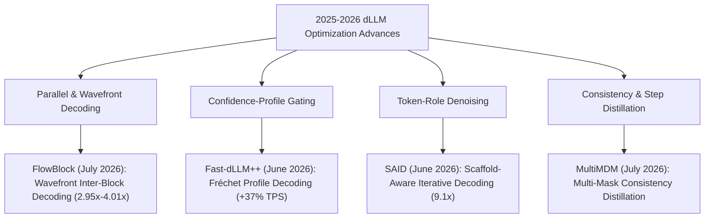

# Wiki Draft: 2026 Literature Survey & Technical Evaluations

## Overview
This wiki draft summarizes the literature survey of discrete diffusion language model (dLLM) optimization papers published in late 2025 and 2026, evaluated against the architecture and empirical findings of the **NeoDiffusion** engine.

---

## Key Findings & Taxonomical Breakdown

### 1. Inter-Block Parallelism via Wavefront Scheduling (*FlowBlock*)
* `[Sourced]`: Serial block decoding in dLLMs has been a major throughput bottleneck. **FlowBlock** (Tian et al., July 2026) resolves this by using token-to-token (T2T) self-correction to decode downstream blocks asynchronously within a bounded wavefront.
* `[Inferred]`: FlowBlock provides the exact solution to **WP-1b MultiBD**'s failure in NeoDiffusion, where naive multi-block expansion suffered severe step-latency penalties (*The Width Rule*).

### 2. Heterogeneous Confidence Gating (*Fast-dLLM++*)
* `[Sourced]`: **Fast-dLLM++** (Kasa et al., June 2026) replaces single worst-case confidence thresholding with Fréchet profile decoding over the full sorted confidence profile.
* `[Inferred]`: Completely training-free and drop-in compatible with `DiffusionEngine+Scheduler.swift`, making it an immediate high-value work package (WP-7a).

### 3. Scaffold-First Denoising (*SAID*)
* `[Sourced]`: **SAID** (Li et al., June 2026) prioritizes denoising steps on structural scaffold tokens before filling details, demonstrating up to 9.1× speedups on LLaDA-8B.

---

## Re-Evaluation of NeoDiffusion Negative Results

| Optimization Strategy | Literature Claim | NeoDiffusion Master List Finding | Verdict for NeoDiffusion |
| :--- | :--- | :--- | :--- |
| **Elastic KV Caching (EKV)** | 3.4x speedup via dynamic KV updates | **WP-1a Elastic-Cache REJECTED**: Active-KV reuse increased steps/block. | ❌ **REJECT**: Pre-banked by `ExactPrefixCache` (*Redundancy Rule #1*). |
| **Naive Multi-Block Decoding** | Sub-linear step reduction | **WP-1b MultiBD / WP-6d REFUTED**: Multi-block step-latency multiplier outweighed step savings. | ⚠️ **REPLACED**: Replace naive MultiBD with FlowBlock wavefront decoding (WP-7b). |

---

## Future Work Packages

- **WP-7a (Fast-dLLM++)**: Implement Fréchet profile decoding in `DiffusionEngine`.
- **WP-7b (FlowBlock)**: Implement Gated Wavefront Decoding for inter-block parallelism.
- **WP-7c (SAID)**: Implement scaffold-aware token step allocation.
